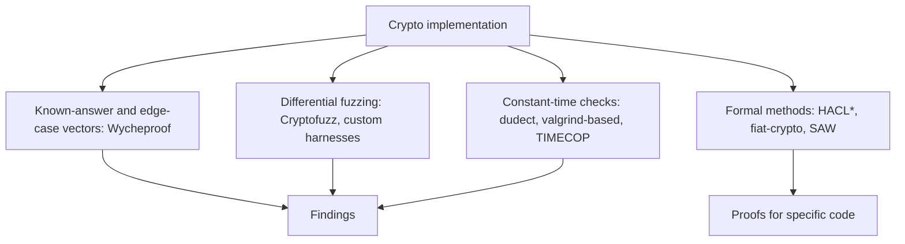

# Why Cryptographic Code Fails

Cryptographic algorithms are usually not what breaks. AES, SHA-256, X25519 and ECDSA over standard curves have held up to decades of analysis. What breaks is the code: an implementation that accepts a signature it should reject, leaks a key through timing, reuses a nonce, or computes a wrong answer for one input in four billion. This book is about testing cryptographic implementations so those flaws are found before attackers find them.

## Why ordinary testing is not enough

Crypto code has properties that make standard testing weak:

- **Correct on almost all inputs.** A carry-propagation bug in big-number arithmetic might affect one input in 2^64. Random unit tests will never hit it.
- **Silent failure.** A signature verifier that accepts invalid signatures passes every test that only checks valid ones.
- **Side channels.** Code can return the right answer and still leak the key through timing, cache access or power. Functional tests cannot see this.
- **Adversarial inputs.** Attackers choose public keys, ciphertexts and parameters. Edge cases such as points not on the curve or zero values are where attacks live.
- **Interoperability pressure.** Libraries are sometimes lenient to accept malformed inputs from other software, and leniency becomes malleability.

## Bug classes

| Class | Example | Consequence |
|---|---|---|
| Missing input validation | accepting an elliptic-curve point not on the curve | **invalid curve attack**: key recovery from ECDH (Jager, Schwenk, Somorovsky, ESORICS 2015, against TLS implementations) |
| Edge-case acceptance | ECDSA verification accepting `r = s = 0` | forged signatures; Java's "psychic signatures" bug, CVE-2022-21449, reported by Neil Madden in 2022 |
| Signature malleability | accepting both `s` and `n - s` in ECDSA, or non-canonical encodings | replay and transaction ID changes; relevant to blockchains |
| Nonce reuse or bias | same ECDSA nonce for two signatures, or slightly biased nonces | private key recovery (directly, or via lattice attacks for bias) |
| Weak randomness | seeding a key generator with a timestamp | predictable keys |
| Arithmetic bugs | incorrect carry, wrong reduction | wrong results, sometimes exploitable |
| Timing leaks | secret-dependent branches or table lookups | key recovery over a network or co-located process |
| API misuse | AES-GCM nonce reuse by the caller, ECB mode | confidentiality or integrity loss |

Nonce reuse has a famous history: the PlayStation 3 ECDSA signing key was recovered in 2010 because the same nonce was used for every signature (presented by fail0verflow), and in 2013 a flaw in Android's `SecureRandom` led to repeated nonces in Bitcoin wallet signatures and theft of funds. Chapter 6 covers more wallet incidents.

## The testing toolkit

This book covers four complementary techniques:

| Technique | Finds | Cost | Chapter |
|---|---|---|---|
| Test vectors | known edge cases and past bugs | very low | 2 |
| Differential fuzzing | arithmetic and parsing differences between libraries | medium | 3 |
| Constant-time analysis | secret-dependent branches and memory access | low to medium | 4 |
| Formal verification | proves functional correctness and some side-channel properties for specific code | high, but reusable | 5 |

## Who should use this book

Library maintainers, auditors reviewing code that implements or wraps cryptography, and engineers of wallets, bridges and blockchain clients where signature handling is consensus- and asset-critical. If you only call a high-level library correctly, the API-misuse sections still apply. For wallets see **mpc-wallet-security** and **ai-agent-wallet-security**.

## Ground rules

Test only libraries you build or install locally. Do not attempt timing attacks against other people's servers. Report vulnerabilities to library maintainers privately; most major libraries publish a security policy. Disclose wallet key-generation flaws with special care, because publishing them before users move funds can cause direct loss.

## Worked example

*Execution status: executed while writing this book (Python 3, `ecdsa` package from PyPI). Observed: the flipped signature `(r, n - s)` verified, exactly one of `s` and `n - s` passed the low-s check, and a signature with `r = s = 0` was rejected with `BadSignatureError`.*

See signature malleability with your own key, on your machine.

1. `pip install ecdsa` (a pure-Python library, fine for experiments, not for production).
2. Generate a secp256k1 key, sign a message, and decode `(r, s)` from the signature with `ecdsa.util.sigdecode_string`.
3. Compute `s2 = n - s` where `n` is the curve order (`ecdsa.SECP256k1.order`).
4. Encode `(r, s2)` with `sigencode_string` and verify it with the same public key.
5. Observe that verification succeeds: both signatures are valid ECDSA signatures for the same message.
6. Write a `is_low_s(s)` check (`s <= n // 2`) and confirm it accepts exactly one of the two. This is the rule Bitcoin and Ethereum adopted for transaction signatures.

## Common pitfalls

- Testing only valid inputs and never checking that invalid ones are rejected.
- Treating a constant-time-looking source file as constant time; compilers can introduce branches.
- Rolling custom primitives instead of testing and using established libraries.
- Assuming pure-Python or educational libraries are suitable for production.
- Publishing details of a wallet key-generation flaw before affected users can respond.

## Exercises

1. Complete the worked example and also try verifying a signature with `r = 0` or `s = 0`; record how the library responds.
2. Pick one library you use and find its security policy and its history of security advisories; classify the last ten by the bug classes above.
3. Write a short threat model for a signature verification function in a blockchain bridge: who controls which inputs, and what each bug class would allow.

## Further reading

- Jager, Schwenk, Somorovsky, "Practical Invalid Curve Attacks on TLS-ECDH", ESORICS 2015.
- Neil Madden, "Psychic Signatures in Java", blog post, 2022.
- [Project Wycheproof](https://github.com/C2SP/wycheproof)
- Bos et al., "Elliptic Curve Cryptography in Practice", Financial Cryptography 2014.
