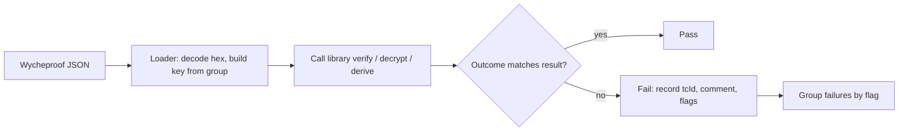

# Test Vectors with Project Wycheproof

Project Wycheproof is a collection of test vectors designed to catch known implementation mistakes in cryptographic libraries. It was started at Google in 2016 by Daniel Bleichenbacher, Thai Duong, Emilia Kasper and Quan Nguyen, and is now maintained in the C2SP (Community Cryptography Specification Project) GitHub organisation. Unlike standard known-answer tests, which mostly confirm that valid inputs give correct outputs, Wycheproof vectors are built around attacks: each one encodes an edge case that has broken a real library or that a known attack relies on.

## What is in it

Wycheproof ships JSON files grouped by algorithm. Coverage includes, among others:

| Family | Examples of what vectors test |
|---|---|
| AEAD (AES-GCM, ChaCha20-Poly1305, AES-SIV and others) | tag truncation, nonce sizes, modified tags, counter wrap |
| ECDSA over many curves and encodings | `r` or `s` zero or out of range, malformed DER, alternative encodings, edge-case public keys |
| EdDSA | non-canonical encodings, small-order points |
| ECDH and X25519/X448 | invalid points, points on twists, low-order points |
| RSA signatures and encryption (PKCS#1 v1.5, PSS, OAEP) | padding edge cases, wrong hash identifiers, Bleichenbacher-style malformed padding |
| MAC, HKDF, key wrap and others | lengths, truncation, edge values |

Each file has a list of **test groups** sharing parameters (a key, a curve, a hash), and each group has **tests** with an ID (`tcId`), a comment, inputs, expected output, a `result`, and **flags** naming the property being tested.

The `result` field is the important one:

- `valid`: the implementation must accept or produce this.
- `invalid`: the implementation must reject this.
- `acceptable`: implementations may differ, usually for legacy-compatibility edge cases. Decide a policy and document it.

## Why vectors catch real bugs

Many famous bugs would have been caught by a single vector. Java's acceptance of ECDSA signatures with `r = s = 0` (CVE-2022-21449) is exactly the kind of case Wycheproof's ECDSA files test: signatures with zero or out-of-range components are marked invalid. Invalid-curve ECDH vectors present public points that are not on the curve; a library that skips the on-curve check computes a result instead of rejecting. Vectors are cheap, deterministic and portable, so there is no reason not to run them in every library's CI.

## Writing a harness

A harness has three parts: a loader that maps JSON fields to your API, a runner that calls the library and compares the outcome with `result`, and a report that groups failures by flag.



Practical notes:

- **Exceptions count as rejection** for `invalid` tests, but distinguish "rejected cleanly" from "crashed". A crash on an invalid input is its own bug.
- **Key parsing failures**: some groups contain public keys your library cannot even parse. Rejecting them at key-load time is usually correct for invalid tests, but check `valid` ones carefully.
- **Encodings**: ECDSA vectors exist for DER and fixed-size (P1363) encodings in separate files. Use the file that matches your API.
- **Schema versions**: the repository has evolved its file layout and schemas over time. Read the schema files in the repository rather than hard-coding field names from old blog posts.

## Integrating into CI

- Vendor a pinned copy of the vectors, or fetch a pinned commit, so tests are reproducible.
- Run on every commit; the full suite is fast for most libraries.
- Fail the build on any `valid`/`invalid` mismatch; log `acceptable` outcomes and review policy changes.
- When Wycheproof adds vectors, update deliberately and treat new failures as potential security bugs.

## Writing your own vectors

Wycheproof cannot cover every protocol. For your own formats, write vectors the same way: every past bug becomes a vector, every validation rule gets at least one valid and one invalid case at its boundary, and every vector carries a comment explaining why it exists. An LLM can draft candidate edge cases from a specification ("list boundary conditions for this signature encoding"), but the only acceptable source of expected results is an independent reference implementation or a hand-computed value checked by a second tool. A model's opinion of what the answer should be is not a test oracle.

## Worked example

*Execution status: not executed in this book's CI; verify locally. No output shown here was observed by the author.*

Run Wycheproof ECDSA secp256k1 vectors against Python's `cryptography` library.

1. `pip install cryptography` and clone `https://github.com/C2SP/wycheproof`.
2. Find the ECDSA secp256k1 SHA-256 DER test file under the test vector directory and open it to read the field names for the public key, message and signature in your checkout's schema.
3. Write a loader along these lines, adjusting field names to the file:

```python
import json
from cryptography.hazmat.primitives.asymmetric import ec
from cryptography.hazmat.primitives import hashes
from cryptography.exceptions import InvalidSignature

data = json.load(open(PATH))
fails = []
for g in data["testGroups"]:
    pub = load_public_key_from_group(g)          # e.g. from DER or uncompressed hex
    for t in g["tests"]:
        try:
            pub.verify(bytes.fromhex(t["sig"]), bytes.fromhex(t["msg"]),
                       ec.ECDSA(hashes.SHA256()))
            ok = True
        except (InvalidSignature, ValueError):
            ok = False
        if (t["result"] == "valid" and not ok) or (t["result"] == "invalid" and ok):
            fails.append((t["tcId"], t["comment"], t["flags"]))
print(len(fails), "mismatches")
```

4. Run it. A mature library should show zero `valid`/`invalid` mismatches.
5. Deliberately break it: wrap `verify` so it returns success whenever `r == 0`, rerun, and see which vectors catch the change.
6. Repeat with the pure-Python `ecdsa` package and compare.

## Common pitfalls

- Ignoring `acceptable` results without writing down a policy.
- Treating crashes on invalid inputs as acceptable rejections.
- Hard-coding JSON field names from an older schema version.
- Running only the vectors for your default curve or hash and skipping others the library supports.
- Taking expected results for custom vectors from an LLM rather than a reference implementation.

## Exercises

1. Run the worked example for two ECDSA curves and both DER and P1363 encodings, and report mismatch counts per flag.
2. Write a Wycheproof harness for X25519 in a library of your choice and check how it handles low-order points.
3. Add three custom vectors for a signature format you use in a project, each with a comment explaining the bug it guards against, and validate expected results with two independent libraries.

## Further reading

- [Project Wycheproof](https://github.com/C2SP/wycheproof)
- Bleichenbacher, "Chosen Ciphertext Attacks Against Protocols Based on the RSA Encryption Standard PKCS #1", CRYPTO 1998.
- Chalkias, Garillot, Nikolaenko, "Taming the Many EdDSAs", SSR 2020.
- [C2SP](https://c2sp.org/)
