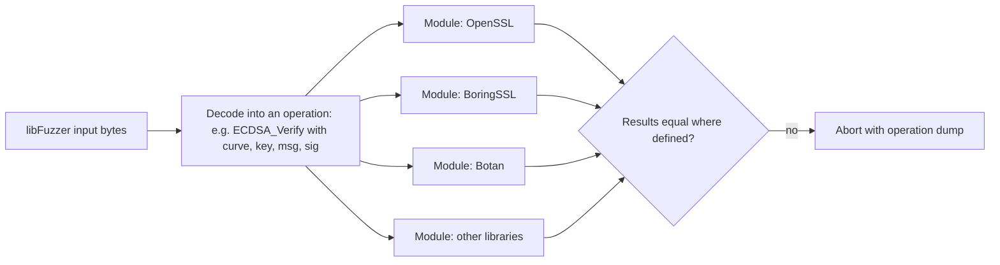

# Differential Fuzzing of Cryptographic Libraries

Test vectors encode bugs someone already thought of. Differential fuzzing finds bugs nobody thought of, by giving the same random input to several implementations of the same operation and flagging any disagreement. Because cryptographic functions are deterministic (or can be made deterministic) and have exact specifications, they are almost ideal targets for this technique.

## Why it works so well for crypto

- **Exact oracles.** `SHA-256(x)` has exactly one right answer. Two libraries that disagree cannot both be right.
- **Many implementations.** OpenSSL, BoringSSL, LibreSSL, libsodium, Botan, Crypto++, mbed TLS, Go's `crypto`, RustCrypto crates, Bouncy Castle and others implement overlapping algorithms.
- **Rare-input bugs.** Big-number and field arithmetic bugs may affect one input in billions. Coverage-guided fuzzers steer towards unusual values (all-ones limbs, values near the modulus) far better than random tests.
- **Parsing.** ASN.1, DER, PEM and point encodings are complex parsers where implementations diverge.

## Cryptofuzz

Cryptofuzz, written by Guido Vranken, is the leading open-source differential fuzzer for cryptographic libraries. It runs continuously in Google's OSS-Fuzz and has found a large number of bugs across many libraries, from memory errors to wrong results in arithmetic and signature handling.

Its architecture:



- **Operations** cover digests, HMAC, symmetric ciphers, KDFs, ECC operations (key generation from private key, sign, verify, ECDH, point arithmetic), big-number arithmetic and more.
- **Modules** wrap each library behind a common interface. A module returns "no result" for unsupported operations, so only libraries that support an operation are compared.
- **Comparison** aborts the process with a detailed dump when results differ, so libFuzzer records the input as a crash.
- **Sanitizers** (ASan, MSan, UBSan) run at the same time, catching memory errors.

Building Cryptofuzz with many modules is involved; its repository documents the build steps per library and the environment variables that enable each module.

## Designing your own differential harness

You do not need Cryptofuzz's full scale to benefit. A small harness for one operation across two or three libraries is a weekend project and often worthwhile for code you maintain.

| Design choice | Recommendation |
|---|---|
| Input decoding | use structured decoding (`FuzzedDataProvider` in libFuzzer, `arbitrary` in Rust) rather than raw byte layouts |
| Determinism | for signatures, use deterministic nonces (RFC 6979) or compare only verification, never raw signatures from randomised signers |
| Undefined cases | decide what "agree" means when one library errors and another succeeds; that disagreement is often the bug |
| Normalisation | compare canonical forms (for example, point compression format, leading zeros in big integers) |
| Reference | include a slow, simple reference (Python big integers, or a formally verified implementation) as a tiebreaker |

## Big-number arithmetic

Many of the most serious arithmetic bugs live in bignum code: modular exponentiation, modular inverse, multiplication with carries, and specialised reduction for specific primes. A focused harness compares library results with Python's arbitrary-precision integers, which are slow but simple:

```python
# Reference check, run on inputs produced by the fuzzer
def check_modexp(lib_result: int, b: int, e: int, m: int):
    if m == 0:
        return  # define policy for undefined inputs
    assert lib_result == pow(b, e, m), (b, e, m)
```

Bias inputs towards boundary values: zero, one, `m - 1`, powers of two, values with all limbs set, and even moduli (some implementations assume odd moduli for Montgomery multiplication).

## Signature verification disagreements

Disagreements in verification are especially important for blockchains, where nodes must agree on validity. If one client accepts a signature another rejects, the network can split. Examples of edge cases where libraries have historically differed include non-canonical encodings, high-`s` ECDSA values, EdDSA verification equations (cofactored versus cofactorless; see "Taming the Many EdDSAs"), and public keys of small order. A differential harness across the libraries used by different clients of one chain is a direct consensus-safety test; see **consensus-protocol-fuzzing**.

## LLM assistance, checked

Writing module wrappers for a new library is boilerplate an LLM can draft. Verification is mechanical: the wrapper must pass the library's own known-answer tests and Wycheproof vectors before it joins the differential harness. Otherwise you will spend your time triaging wrapper bugs. LLMs can also propose boundary inputs for a new operation; add them to the seed corpus, and let the fuzzer and comparison decide whether they reveal anything.

## Worked example

*Execution status: not executed in this book's CI; verify locally. No output shown here was observed by the author.*

Build a two-library differential fuzzer for SHA-256 and ECDSA verification in Rust with `cargo-fuzz`, on your own machine.

1. `cargo install cargo-fuzz` and create a crate with `cargo fuzz init`.
2. Add dependencies on `sha2`, `k256` (RustCrypto) and `ring` or the `openssl` crate.
3. Write a fuzz target that takes bytes, hashes them with both libraries, and asserts equality.
4. Add a second target that splits input into a public key, message and DER signature, verifies with both libraries, and asserts that both accept or both reject. Wrap key parsing so that parse failure counts as reject.
5. Run `cargo fuzz run verify -- -max_total_time=600`.
6. If it aborts, rerun the saved crash input, print both libraries' decisions and the parsed values, and check against Wycheproof and the relevant standard to decide which library is wrong, or whether the difference is a documented policy (for example, low-`s` enforcement).
7. Record your agreement policy in code comments so later runs stay consistent.

## Common pitfalls

- Comparing outputs of randomised signing directly instead of using deterministic nonces or verification.
- Counting policy differences (strict versus lenient encodings) as bugs without checking documentation.
- Wrapper bugs dominating findings because wrappers were not validated against known-answer tests first.
- Fuzzing without sanitizers, missing memory errors in C libraries.
- Ignoring error-versus-success disagreements, which are often the most interesting.

## Exercises

1. Implement the worked example and run it for one hour; document any disagreements and your resolution.
2. Write a bignum modular-inverse harness against Python integers for a C library, biasing inputs to even moduli and `m - 1`.
3. Read the Cryptofuzz README, list its supported operations for ECC, and identify one operation your favourite library supports that no module currently compares.

## Further reading

- [Cryptofuzz](https://github.com/MozillaSecurity/cryptofuzz)
- [OSS-Fuzz](https://google.github.io/oss-fuzz/)
- [cargo-fuzz book](https://rust-fuzz.github.io/book/cargo-fuzz.html)
- Chalkias, Garillot, Nikolaenko, "Taming the Many EdDSAs", SSR 2020.
- **ai-fuzzing-field-guide**
