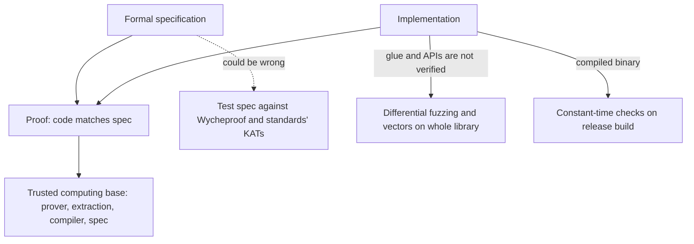

# Formal Approaches: HACL*, fiat-crypto and Friends

Testing shows the presence of bugs. For the small, critical core of a cryptographic library (field arithmetic, primitive implementations, constant-time behaviour) it is now practical to prove their absence, for specific properties and under stated assumptions. Verified code from several projects already ships in mainstream software. This chapter explains what these projects prove, how their output is used, and how testing still fits around them.

## What can be proved

| Property | Meaning | Example tools |
|---|---|---|
| Functional correctness | the code computes exactly the mathematical specification for all inputs | HACL*, fiat-crypto, Cryptol/SAW, Jasmin |
| Memory safety | no out-of-bounds or use-after-free | HACL* (F* / Low*), Rust plus verification |
| Secret independence | no secret-dependent branches or addresses (in a stated leakage model) | HACL* secret integer types, Jasmin, ct-verif |
| Protocol-level security | the protocol meets security definitions | ProVerif, Tamarin, EasyCrypt, CryptoVerif |

This book focuses on implementations. For protocol proofs and general theorem proving, see **lean4-security-proofs** and **rust-formal-verification**.

## HACL* and the Everest family

HACL* is a library of verified cryptographic primitives written in F* (in its low-level subset Low*) and compiled to C by the KaRaMeL tool, presented by Zinzindohoué, Bhargavan, Protzenko and Beurdouche, "HACL*: A Verified Modern Cryptographic Library", ACM CCS 2017. Proofs cover functional correctness against a high-level specification, memory safety and secret independence via abstract secret integer types that disallow branching on secrets. HACL* code is used in Mozilla's NSS, among other projects, and the verified code is also packaged together with assembly from Vale in the EverCrypt provider.

## fiat-crypto

fiat-crypto (Erbsen, Philipoom, Gross, Sloan, Chlipala, "Simple High-Level Code For Cryptographic Arithmetic – With Proofs, Without Compromises", IEEE S&P 2019) generates field arithmetic code from specifications, with correctness proofs in the Coq (now Rocq) proof assistant. Given a prime and a representation, it emits C, Rust, Go and other languages. BoringSSL uses fiat-crypto-generated field arithmetic for several curves, and its generated code appears in other projects too. Because arithmetic carry bugs are a classic source of rare wrong results, generated and proved arithmetic removes a whole class of bugs that differential fuzzing (chapter 3) otherwise hunts.

## SAW, Cryptol and industrial verification

Galois's Cryptol is a specification language for cryptographic algorithms, and SAW (Software Analysis Workbench) proves that C, Java or LLVM code matches a Cryptol specification, typically using SAT/SMT solvers. AWS has published work using SAW and related tools to verify parts of s2n-tls and AWS-LC. These efforts show a practical pattern: a readable specification, an existing optimised implementation, and an automated equivalence proof that is re-run in CI.

## Jasmin and libjade

Jasmin is a language for writing high-speed cryptographic code close to assembly, with a verified compiler and tooling for proving correctness and constant-time properties (with EasyCrypt). libjade collects Jasmin implementations, including post-quantum schemes. This approach targets the gap between portable C and hand-written assembly, where many performance-critical implementations live.

## How verification and testing fit together

Verification shifts trust rather than removing it:

- **The specification can be wrong.** Test specifications against official known-answer tests and Wycheproof vectors.
- **Glue code is usually not verified.** Parsing, API wrappers and key management around verified cores still need fuzzing.
- **Compilers and toolchains.** Unless the compiler is verified (CompCert, the Jasmin compiler), the binary could differ from the proved source; see **compiler-fuzzing**. Constant-time checks on release binaries remain useful.
- **Leakage model.** "Secret independent" is relative to a model, usually branches and memory addresses, not speculative execution or power.

## AI assistance in formal work

LLMs are increasingly used to draft specifications, loop invariants and proof scripts. This is safe precisely because proof assistants check proofs: a proof either passes the checker or it does not. Two cautions apply:

- A model that writes both specification and proof can prove the wrong thing. Specifications must be reviewed by humans and tested against known-answer vectors.
- "Admitted" lemmas, `sorry` placeholders and axioms must be searched for and rejected in CI; a proof that relies on them proves nothing.

## Worked example

*Execution status: not executed in this book's CI; verify locally. No output shown here was observed by the author.*

Generate verified field arithmetic with fiat-crypto and test it differentially.

1. Clone `https://github.com/mit-plv/fiat-crypto`. Pre-generated code for common curves is in its `fiat-c`, `fiat-rust` and similar directories, so you do not need to rebuild the proofs to use it.
2. Pick the Curve25519 64-bit C file and read the header comment, which records the command that generated it.
3. Write a small C harness that converts random 255-bit integers to the representation, multiplies them with the generated multiplication function, converts back, and prints the result.
4. Compare against Python's `(a * b) % (2**255 - 19)` for 100,000 random inputs and for boundary inputs (0, 1, p - 1, values above p).
5. Note the generated code's input bounds stated in comments; inputs outside them are outside the proof's precondition, so test the harness respects them.
6. Run the harness under the Valgrind constant-time technique from chapter 4 with inputs marked secret.

## Common pitfalls

- Treating "verified" as "bug free" without reading what was proved and what is trusted.
- Calling verified functions outside their documented preconditions (input bounds).
- Verifying a core and leaving parsing and API glue untested.
- Accepting AI-generated proofs that contain `admit`, `sorry` or new axioms.
- Assuming a verified source implies a constant-time binary after compilation.

## Exercises

1. Complete the worked example and record whether any input inside the stated bounds produced a mismatch.
2. Read the HACL* documentation and list, for one primitive, which properties are proved and what the trusted computing base includes.
3. Write a Cryptol specification for a toy function (for example, a 32-bit rotate-and-xor mix) and use SAW to prove a C implementation equivalent; then introduce a bug and observe the counterexample.

## Further reading

- Zinzindohoué et al., "HACL*: A Verified Modern Cryptographic Library", ACM CCS 2017.
- Erbsen et al., "Simple High-Level Code For Cryptographic Arithmetic – With Proofs, Without Compromises", IEEE S&P 2019.
- [HACL* / hacl-star](https://github.com/hacl-star/hacl-star), [fiat-crypto](https://github.com/mit-plv/fiat-crypto)
- [SAW](https://saw.galois.com/) and [Cryptol](https://cryptol.net/)
- Barbosa et al., "SoK: Computer-Aided Cryptography", IEEE S&P 2021.
