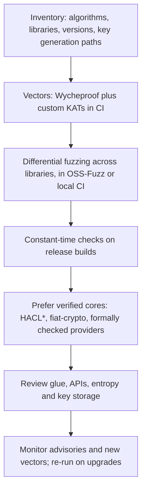

# Wallet and Blockchain Crypto, and a Testing Programme

Blockchain systems put cryptographic implementation bugs under unusual pressure. Keys directly control assets, signatures are public forever, and every node must agree on which signatures are valid. This final chapter covers crypto failure modes that recur in wallets and chains, then assembles the techniques from earlier chapters into a testing programme with a checklist and research directions.

## Failure modes in wallets and chains

| Failure | What happens | Testing response |
|---|---|---|
| Weak key generation | keys derived from low-entropy seeds can be brute-forced | entropy source review, statistical tests on generated keys, code review of seeding |
| Nonce reuse or bias in ECDSA | private key recovery from public signatures | deterministic nonces (RFC 6979) with KAT tests; scanning own signatures for repeated `r` |
| Signature malleability | transaction or message hashes change; replay in contracts that track signatures by bytes | low-`s` enforcement tests; tests that contracts key replay protection by message, not signature bytes |
| Verification disagreement between clients | consensus split | differential fuzzing across client libraries |
| Address and encoding bugs | funds sent to unspendable or wrong addresses | vectors for checksums and encodings (BIP 173/350 vectors for Bech32/Bech32m, EIP-55 for Ethereum checksums) |
| Smart-contract signature handling | `ecrecover` returns zero address on invalid input; missing chain ID or contract binding | unit and fuzz tests for zero-address handling and domain separation (EIP-712) |

## Incidents worth studying

These incidents are widely documented; read the original disclosures for details and figures.

- **Android `SecureRandom` (2013).** A flaw in Android's random number generation led to repeated ECDSA nonces in some Bitcoin wallet apps, and keys were recovered from public signatures.
- **Profanity vanity addresses (2022).** The Profanity vanity address generator derived keys from a small seed space; 1inch published an analysis showing keys could be recovered, and later in 2022 a loss at Wintermute of roughly US$160M was publicly attributed to a Profanity-generated address.
- **Milk Sad (2023).** Researchers reported that Libbitcoin Explorer's `bx seed` command used a weak, time-seeded pseudo-random generator, making wallets created with it recoverable; funds were stolen from affected wallets.
- **Randstorm (2023).** Unciphered reported weaknesses in browser-based key generation from the early 2010s, involving older versions of BitcoinJS and the browser randomness available at the time.

The common thread: the cryptography was standard; the randomness or its use was not. Testing must include entropy sources and key-generation paths, not only algorithms.

## Contract-level signature hygiene

On-chain verification adds its own rules, covered further in **account-abstraction-security** and **neurosymbolic-contract-verification**:

- `ecrecover` returns `address(0)` on failure; code must reject that result.
- Enforce low-`s` (OpenZeppelin's `ECDSA` library does) if signatures are used as identifiers.
- Bind signatures to chain ID, contract address and a nonce (EIP-712 domain separators).
- Test with Foundry fuzzing: generate random keys with `vm.sign`, then mutate signatures (`s` to `n - s`, flip `v`, zero `r`) and assert the contract's acceptance matches your policy.

## A testing programme

## Checklist

- [ ] Inventory every cryptographic library, version and algorithm in use, including transitive dependencies.
- [ ] Wycheproof vectors run in CI for every supported algorithm; `acceptable` policy documented.
- [ ] Custom vectors for every past bug and every protocol-specific encoding.
- [ ] Differential fuzzing for any operation with consensus or asset impact, across all libraries your ecosystem uses.
- [ ] Constant-time checks (Valgrind-style or dudect) on release builds of code handling secrets.
- [ ] Deterministic or audited nonce generation; tests that reject repeated nonces in your own signing service logs.
- [ ] Entropy sources reviewed; no time-seeded or language-default PRNGs for keys.
- [ ] Verified implementations preferred for core arithmetic where available.
- [ ] AI-generated tests, vectors or proofs accepted only after independent tool validation (reference implementations, proof checkers, fuzzers).
- [ ] Private disclosure routes known for every library you depend on.

## Research directions

- **Post-quantum implementations.** ML-KEM and ML-DSA (FIPS 203 and 204) implementations are newer and have fewer years of scrutiny; vector suites, differential fuzzing and constant-time analysis for them are active areas.
- **Threshold and MPC signing.** Implementations combine many primitives and protocols; bugs have been found in published libraries. Testing tooling lags behind; see **mpc-wallet-security**.
- **Zero-knowledge proof systems.** Soundness bugs in circuits and verifiers are crypto implementation bugs of a new kind; see **zk-circuit-security**.
- **Microarchitectural leakage models.** Extending constant-time tools to speculative execution at scale.
- **AI-proposed edge cases with verified oracles.** Using models to suggest adversarial inputs and specifications, with reference implementations and proof checkers as the only judges.

## Worked example

*Execution status: not executed in this book's CI; verify locally. No output shown here was observed by the author.*

Scan your own wallet's signatures for repeated ECDSA nonces.

1. Export the signatures your signing service produced (from logs, or by re-parsing your own transactions from a local node or block explorer API).
2. Parse each signature into `(r, s)`; for Ethereum transactions, `r` and `s` are fields of the transaction, for Bitcoin parse DER from the input script.
3. Group by `r`. Any `r` appearing in two signatures from the same key is a critical finding: rotate the key immediately and move funds.
4. Also check the distribution of `r` bit lengths; a strong bias towards short values can indicate biased nonces.
5. Add the scan as a scheduled job so new signatures are checked continuously.

Only analyse signatures from keys you control or are authorised to assess.

## Common pitfalls

- Testing algorithms and ignoring the randomness source that feeds them.
- Using signatures as unique identifiers without enforcing canonical form.
- Forgetting that consensus nodes need agreement more than strictness; test cross-client behaviour.
- Upgrading a crypto library without rerunning vectors and differential tests.
- Publishing key-recovery details before affected users have been warned.

## Exercises

1. Write a Foundry test that checks a signature-verifying contract rejects `address(0)` recoveries, high-`s` signatures and signatures from another chain ID.
2. Build the nonce-reuse scanner from the worked example and test it on a synthetic dataset where you deliberately reuse a nonce with a throwaway key.
3. Produce an inventory of cryptographic libraries used by one open-source wallet and map each to the techniques in this book.

## Further reading

- [RFC 6979: Deterministic Usage of DSA and ECDSA](https://www.rfc-editor.org/rfc/rfc6979)
- [EIP-712](https://eips.ethereum.org/EIPS/eip-712) and [EIP-2](https://eips.ethereum.org/EIPS/eip-2)
- Milk Sad disclosure, [milksad.info](https://milksad.info/)
- Breitner, Heninger, "Biased Nonce Sense: Lattice Attacks against Weak ECDSA Signatures in Cryptocurrencies", Financial Cryptography 2019.
- **mpc-wallet-security**, **ai-agent-wallet-security**, **zk-circuit-security**
